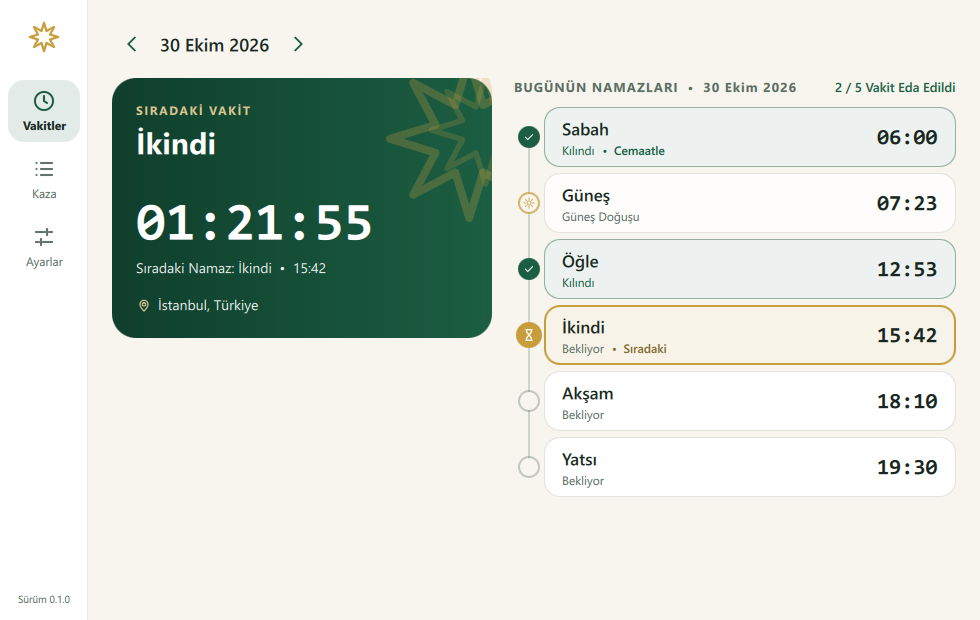
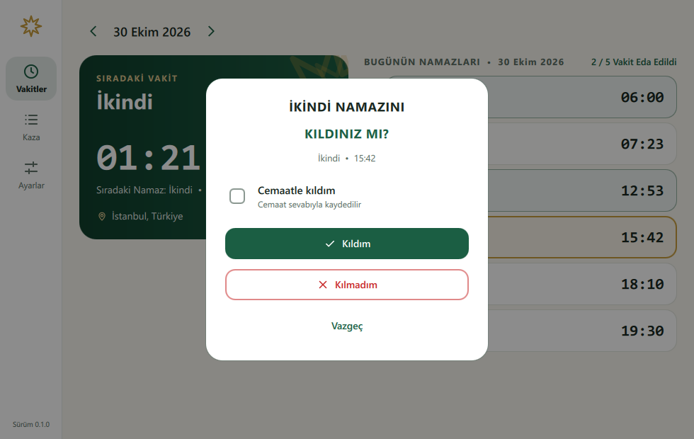
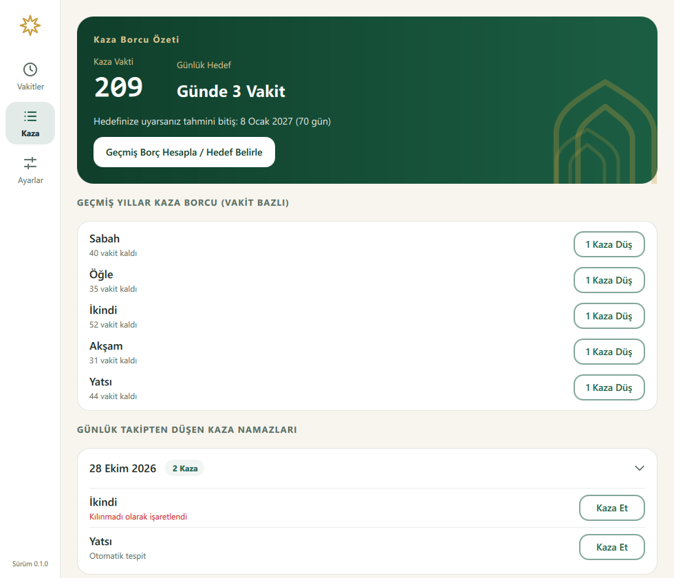
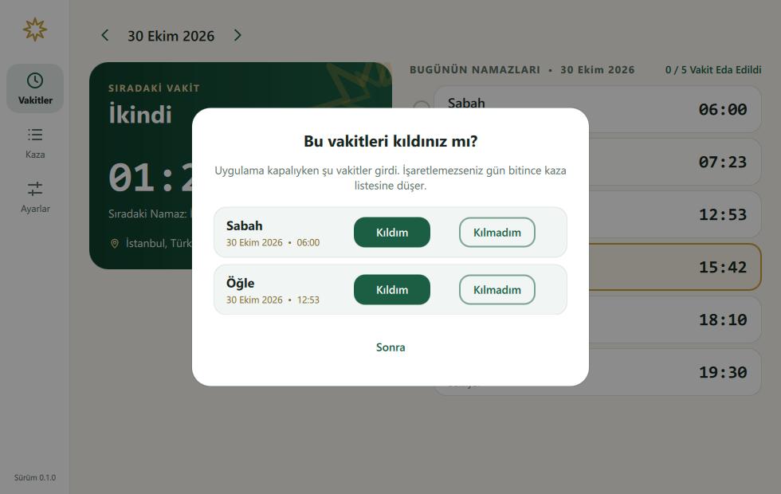
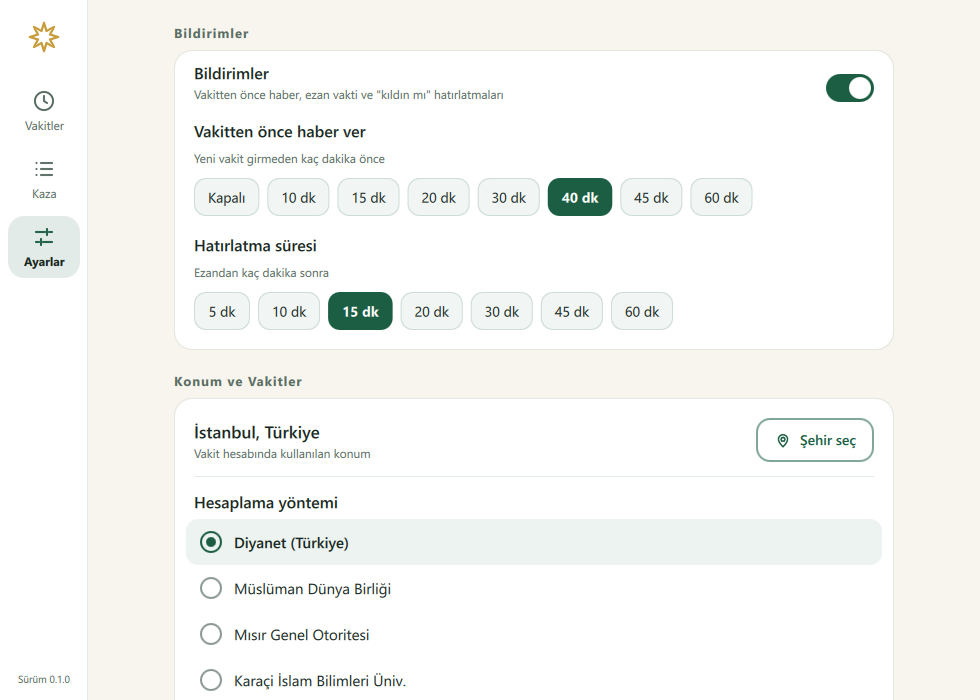
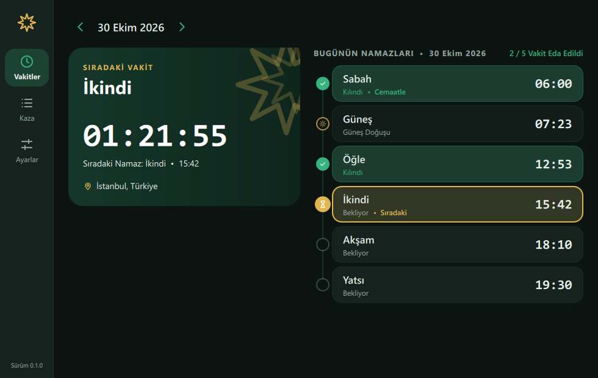

# Namaz Takip Masaüstü

Ezan vakitlerini gösteren, kıldığınız namazları işaretlemenizi sağlayan ve kaza borcunuzu takip eden sade bir **Windows masaüstü uygulaması**. Bilgisayarınız açıkken sistem tepsisinde sessizce çalışır; vakit girmeden haber verir, vakit girince bildirim gösterir.

Python + PySide6 (QML) + SQLite ile yazıldı. Verileriniz yalnızca kendi bilgisayarınızda durur; hesap, internet bağlantısı ya da sunucu gerekmez.

<p align="center">
  
</p>

## Özellikler

- **Vakitler ve geri sayım.** Sabah, Güneş, Öğle, İkindi, Akşam ve Yatsı saatleri; sıradaki vakte kalan süre saniye saniye akar. Önceki ve sonraki günlere göz atabilirsiniz.
- **Namaz işaretleme.** Her vakit için *Kıldım* (isterseniz *cemaatle*) veya *Kılmadım*. Geçmiş günleri de düzeltebilirsiniz.
- **Kaza takibi.** İşaretlemediğiniz ya da "kılmadım" dediğiniz vakitler otomatik olarak kaza listesine düşer. Geçmiş yıllardan kalan borcu yıl/ay/gün olarak hesaplatabilir, günlük hedef belirleyip tahmini bitiş tarihini görebilirsiniz.
- **Akıllı bildirimler.** Vakitten önce haber (varsayılan 40 dk), vakit girince ezan bildirimi, işaretlemediyseniz "kıldınız mı?" hatırlatması. Bildirime tıklayınca ilgili vaktin işaretleme penceresi açılır.
- **Kapalıyken kaçan vakitler.** Bilgisayar kapalıyken giren vakitler için bir sonraki açılışta tek seferlik "bu vakitleri kıldınız mı?" sorusu çıkar.
- **Tepside çalışır.** Pencereyi kapatınca uygulama tepsiye iner; Windows açılışında kendiliğinden başlayabilir (isteğe bağlı).
- **81 il, 6 hesaplama yöntemi.** Varsayılan Diyanet; Müslüman Dünya Birliği, Mısır, Karaçi, Ümmü'l-Kura ve ISNA da seçilebilir.
- **5 tema.** Selçuklu Zümrüdü, Koyu, Okyanus, Gül Kurusu ve Altın.
- **Günlük yedek.** Veritabanı her gün otomatik yedeklenir (son 7 yedek tutulur).

## Ekran görüntüleri

| | |
|---|---|
|  |  |
| **İşaretleme:** vakte tıklayın, *Kıldım* / *Kılmadım* deyin. | **Kaza:** otomatik tespit edilen vakitler ve geçmiş borç planı. |
|  |  |
| **Açılış sorusu:** bilgisayar kapalıyken giren vakitler. | **Ayarlar:** bildirimler, konum, hesaplama yöntemi, tema. |

<p align="center">
  <br>
  <sub>Koyu tema</sub>
</p>

## Kullanım

### İlk açılış

1. Uygulamayı açın; **şehrinizi** seçin (arama kutusu Türkçe karakterlerden bağımsız çalışır).
2. Windows açılınca başlasın mı sorusuna cevap verin (sonradan Ayarlar'dan değiştirilebilir).
3. Vakitler ekranı hazır: sıradaki vakit ve geri sayım en üstte görünür.

### Günlük kullanım

- Bir vakte tıklayın → **Kıldım** (cemaatle kıldıysanız kutuyu işaretleyin) veya **Kılmadım**. Yanlış işaretlerseniz aynı vakte yeniden tıklayıp düzeltin.
- Kaza ekranında bir vakti kaza ettiğinizde **Kaza Et**'e basın; listeden çıkar.
- Geçmiş yıllardan kalan borcunuz için **Geçmiş Borç Hesapla / Hedef Belirle**'yi kullanın; kıldıkça **1 Kaza Düş** ile sayacı azaltın.
- Klavye kısayolları: `Ctrl+1` Vakitler, `Ctrl+2` Kaza, `Ctrl+3` Ayarlar.

### Gün sınırı

Gece yarısından sonra kıldığınız Yatsı "dünün" namazı sayılır. Takip günü, Sabah vaktinde (en geç 04:00'te) değişir.

### Bildirimler ve tepsi

Uygulama **çalışırken** bildirim verir. Pencereyi kapatmak uygulamayı kapatmaz, tepsiye indirir; tamamen kapatmak için tepsi simgesine sağ tıklayıp **Çıkış**'ı seçin. Tepsi menüsünden pencereyi gösterebilir, bildirimleri açıp kapatabilirsiniz.

Uygulama kapalıyken ya da bilgisayar uykudayken bildirim gelmez. Bildirimleri güvenilir almak için *Windows açılışında başlat* seçeneğini açık tutun.

### Verileriniz

Her şey `%APPDATA%\NamazTakip\` klasöründedir:

| Dosya | İçerik |
|---|---|
| `namaz_takip.db` | İşaretleriniz ve ayarlarınız (SQLite) |
| `backups\` | Günlük yedekler (son 7) |
| `logs\` | Günlük dosyaları |

Uygulamayı silmek verilerinizi silmez. Yedeği geri yüklemek için uygulamayı kapatıp yedek dosyasını `namaz_takip.db` adıyla kopyalamanız yeterlidir.

## Kurulum

Henüz hazır bir kurulum dosyası yayınlanmıyor; uygulamayı kaynaktan çalıştırabilir veya tek dosya `exe` üretebilirsiniz. Gereken: **Windows** ve **Python 3.10**.

```powershell
git clone https://github.com/Yusufygc/NamazTakip-Desktop.git
cd NamazTakip-Desktop
python -m venv venv
venv\Scripts\activate
pip install -r requirements-dev.txt
python main.py
```

### Tek dosya exe üretme

```powershell
pip install -r requirements-build.txt
python tools/build_exe.py
```

Çıktı `dist\NamazTakip.exe` olur (yaklaşık 56 MB). Tek dosyadır; istediğiniz klasöre kopyalayıp oradan çalıştırabilirsiniz. Her açılışta paket geçici klasöre açıldığı için pencere birkaç saniyede görünür. *Windows açılışında başlat* seçeneği exe'nin bulunduğu yolu kaydeder; exe'yi kalıcı bir klasöre koyun.

> İmzasız bir exe olduğundan Windows SmartScreen / Akıllı Uygulama Denetimi uyarı verebilir.

## Nasıl çalışıyor?

- **Vakit hesabı** [`adhanpy`](https://pypi.org/project/adhanpy/) ile yapılır, Diyanet kurallarına göre (yuvarlama ve Güneş için güvenlik payı dahil). Çıktılar, mobil uygulamanın ürettiği 1060 satırlık bir referans tabloyla saniyesine kadar karşılaştırılır (`tests/data/golden_times.json`).
- **Kaza listesi saklanmaz, türetilir.** Her gün için beş vakit incelenir; kılınmamış veya işaretlenmemiş geçmiş vakitler kaza olur. İşaretlenmeyen bir günü sonradan düzeltmek listeyi kendiliğinden günceller.
- **Katmanlı mimari.** `ui/qml → bridge → services → core/repositories → core/domain`; ters yön yasak ve testle denetlenir. İş kuralları Qt'den bağımsız saf Python'dur.
- **Test.** 400'ü aşkın test: iş kuralları, SQLite, servisler, gerçek QML arayüzü (ekransız), kontrast (WCAG AA) ve mimari kuralları.

Ayrıntılı proje bilgisi [`docs/wiki/`](docs/wiki/index.md) altındadır: mimari, vakit hesabı, kaza kuralları, veri katmanı, bildirim/tepsi, dağıtım ve alınan kararlar.

## Geliştirme

```powershell
venv\Scripts\activate
python main.py                # çalıştır
python -m pytest              # testler
python -m ruff check .        # lint
python tools/build_exe.py     # exe derle
```

| Klasör | İçerik |
|---|---|
| `app/core/domain/` | Saf iş kuralları: vakit hesabı, takip günü, kaza |
| `app/core/` | SQLite, ayar ve işaret depoları, yedek, günlük, metinler |
| `app/services/` | Ayar, vakit, kaza, saat, autostart, tek örnek servisleri |
| `app/bridge/` | Python ↔ QML köprüleri |
| `app/ui/qml/` | Arayüz (sayfalar, bileşenler, temalar) |
| `tests/` | Testler |
| `tools/` | Simge üretimi, exe derleme betiği |
| `docs/wiki/` | Proje bilgi tabanı |

## Sınırlar

- Yalnızca Windows (Windows 11'de geliştirildi ve denendi).
- Uygulama kapalıyken ya da bilgisayar uykudayken bildirim gelmez.
- Vakitler seçili şehre göre hesaplanır; seyahatte şehri kendiniz değiştirmelisiniz. Konum otomatik bulunmaz.
- Veriler eşitlenmez; mobil uygulamayla bağlantı yoktur.

## Kullanılan kütüphaneler

[PySide6](https://doc.qt.io/qtforpython-6/) (Qt, LGPL), [adhanpy](https://pypi.org/project/adhanpy/), [PyInstaller](https://pyinstaller.org/), pytest ve ruff.
